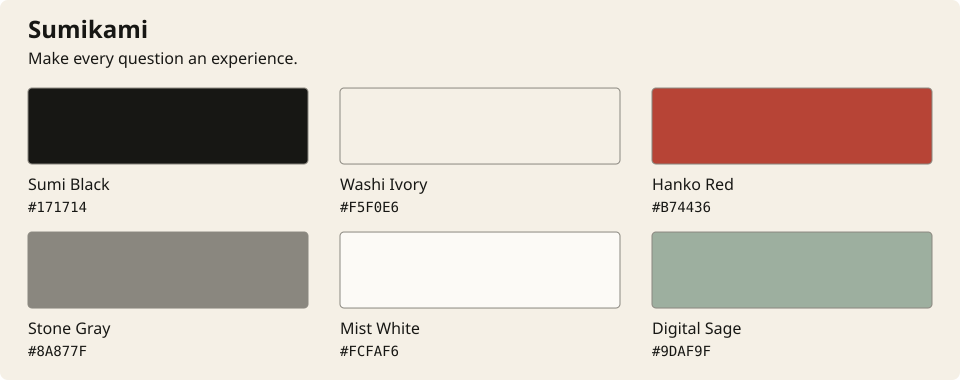

# Sumikami — brand identity

**墨 × 紙 · INK MEETS INTERACTION**

**Make every question an experience.**

Status: selected brand direction for the product previously described as FormCraft. This guide defines the product identity; logo assets, font integration, and interface styling remain future implementation work.

## Positioning and personality

Sumikami is a design-first form-building platform that transforms ordinary data collection into expressive, interactive experiences.

It should feel like traditional Japanese ink painting brought into the future: expressive, minimal, atmospheric, and technologically sophisticated. Its personality is **artistic, futuristic, thoughtful, precise, and immersive**.

The philosophy is simple: a blank page is full of possibilities. Every question is a brushstroke, and every response helps create something meaningful. Ink is the visual signature; the platform supports creative directions well beyond Japanese aesthetics.

## Brand and form themes are separate systems

| System                 | What it controls                                                                                   | What stays recognizable                                                               |
| ---------------------- | -------------------------------------------------------------------------------------------------- | ------------------------------------------------------------------------------------- |
| Sumikami brand         | Product name, wordmark/symbol, voice, marketing, product chrome and shared interaction conventions | Precise typography, restrained composition, ink/paper foundation, selective Hanko Red |
| Product interface      | Dashboard, editor tools, workspace settings and response management                                | Fast, professional controls and predictable navigation in light/dark modes            |
| Selectable form themes | Respondent-facing layout, colors, editorial typography, backgrounds and optional motion            | Accessible interaction and reliable form behavior; visual expression can vary widely  |

Japanese Ink is one [form-theme direction](../design/japanese-ink.md). Future themes may be city-inspired, futuristic, brand-specific, or custom. A user creating an unrelated visual style should still recognize Sumikami in the editor and product experience. Changing the dashboard mode must not rewrite a published form's theme.

## Brand palette

| Color        | Value     | Primary role                                                                       |
| ------------ | --------- | ---------------------------------------------------------------------------------- |
| Sumi Black   | `#171714` | Primary text, identity, dark surfaces                                              |
| Washi Ivory  | `#F5F0E6` | Canvas and warm backgrounds                                                        |
| Hanko Red    | `#B74436` | Distinctive brand accents and selected important actions                           |
| Stone Gray   | `#8A877F` | Quiet rules, secondary visual details, supporting large text where contrast allows |
| Mist White   | `#FCFAF6` | Cards and light surfaces                                                           |
| Digital Sage | `#9DAF9F` | Optional subtle interactive surfaces and supporting accents                        |

Sumi Black and Washi Ivory should account for roughly 85% of the overall interface impression. Mist White and restrained neutral shades support hierarchy. Hanko Red is deliberate and sparse; sage is optional. This is a composition guideline, not a quota that overrides legibility or semantic states.

Use ink-filled controls for routine primary actions, with Hanko Red available for one important creative action or brand moment. Avoid making every button, navigation item, and chart series red. Keep destructive/error styling semantically distinct and explicitly labeled; a red brand accent must not be the only error signal. Avoid generic SaaS blue and excessive neon in the core identity; independent form themes may use other palettes.

### Accessible application colors

Brand swatches are not interchangeable semantic UI tokens. Derive readable supporting colors and mode-specific variants while retaining the six base swatches above as the brand reference.

Calculated solid sRGB contrast ratios, rounded to two decimal places:

| Combination                                     | Ratio   | Usage guidance                                                                      |
| ----------------------------------------------- | ------- | ----------------------------------------------------------------------------------- |
| Sumi Black on Washi Ivory                       | 15.81:1 | Body text and headings                                                              |
| Stone Gray on Washi Ivory                       | 3.16:1  | Insufficient for normal-size text; reserve for suitable large text or non-text uses |
| Stone Gray on Mist White                        | 3.44:1  | Insufficient for normal-size help text or placeholders                              |
| Derived supporting ink `#68645D` on Washi Ivory | 5.18:1  | Starting point for readable secondary text                                          |
| Mist White on Hanko Red                         | 5.17:1  | Candidate filled-action label pair                                                  |
| Washi Ivory on Hanko Red                        | 4.75:1  | Candidate filled-action label pair                                                  |
| Hanko Red on Sumi Black                         | 3.33:1  | Insufficient for normal-size text in dark mode; derive a lighter red                |
| Sumi Black on Digital Sage                      | 7.75:1  | Candidate label on a sage surface                                                   |

Normal-size text needs at least 4.5:1 for the WCAG 2.2 AA target; required control/state indicators need appropriate non-text contrast. See the [text contrast guidance](https://www.w3.org/WAI/WCAG22/Understanding/contrast-minimum.html) and [non-text guidance](https://www.w3.org/WAI/WCAG22/Understanding/non-text-contrast.html). Recheck actual components, adjacent surfaces, hover states, overlays and any texture. These measurements do not establish accessibility of an unbuilt interface.

## Logo family

Develop three related assets rather than scaling one detailed illustration into every context:

| Asset           | Direction                                                                     | Intended use                                                                                |
| --------------- | ----------------------------------------------------------------------------- | ------------------------------------------------------------------------------------------- |
| Primary logo    | Minimal Ensō-inspired ink-circle symbol paired with a clean Sumikami wordmark | Product header, sign-in, marketing navigation, presentations                                |
| App icon        | Simplified black brushstroke and red dot, readable at 24–32px                 | App identity, compact navigation and avatar-like placements; verify a separate 16px favicon |
| Expressive logo | More detailed ink illustration built around the same visual signature         | Launch visuals, marketing heroes, special form themes                                       |

Keep the production symbol simple, reproducible in one color, and recognizable without a textured background. Evaluate a red sun/dot as the restrained identity accent. Mountains, temples, cherry blossoms and elaborate brush textures belong to optional large artwork; they must not be required for recognition at small sizes.

Review positive/reversed versions, monochrome, small sizes, clear space, wordmark legibility and use on varied form backgrounds before approving exports. Use vector masters for the primary mark and icon, with raster exports only where required. The palette SVG accompanying this guide is a color reference, not a production logo. No final logo has been generated or approved by this documentation change.

## Typography

| Role                                   | Direction                               | Implementation note                                                                             |
| -------------------------------------- | --------------------------------------- | ----------------------------------------------------------------------------------------------- |
| Product interface                      | **Inter**                               | Primary choice for navigation, labels, ordinary questions, controls and data views              |
| Alternative UI exploration             | Plus Jakarta Sans                       | An alternative for later comparison, not a second concurrent interface font                     |
| Editorial and Japanese-language accent | **Noto Serif JP**                       | Selected story headings and suitable Japanese text; verify script coverage and actual rendering |
| Technical values                       | Existing Geist Mono or system monospace | IDs, shortcuts, code-like values and aligned technical details                                  |

Use “Create something extraordinary.” as a clean UI specimen and “The art of asking.” as an editorial specimen. Decorative brush fonts should not appear in ordinary questions, labels or inputs. Keep serif treatments selective so the editor remains efficient and precise.

The repository currently bundles Geist Sans and Geist Mono. They are the interim implementation, not the newly selected brand typeface. Integrate the chosen faces during the UI phase after checking distribution notices, weights, loading strategy, fallbacks and language coverage. This document does not install fonts or replace existing font files.

## Taglines and voice

The primary tagline is **Make every question an experience.** Use it consistently beside the product name in launch messaging and the main marketing introduction.

| Line                                 | Best use                    |
| ------------------------------------ | --------------------------- |
| Make every question an experience.   | Primary brand tagline       |
| Form experiences beyond ordinary.    | Marketing and landing pages |
| The art of asking.                   | Minimal, premium campaigns  |
| Where questions become journeys.     | Immersive form experiences  |
| Design beyond the form.              | Product positioning         |
| Every response tells a story.        | Storytelling campaigns      |
| From blank canvas to connection.     | Brand storytelling          |
| Crafted to ask. Designed to inspire. | Creative marketing          |

Marketing can be expressive; controls and feedback should be direct. Use “Create form,” “Publish form,” “Saved,” and “Submission received.” Explain errors in plain language. Keep the blank-page/brushstroke metaphor in storytelling rather than making users interpret poetic labels to finish a task.

## Product and architecture implications

The product UI should stay minimal, fast and professional. Atmospheric artwork, immersive transitions and more expressive typography belong to intentional marketing/form experiences, with accessibility and reduced-motion behavior preserved.

The database already provides immutable `form_versions.settings` for future validated appearance configuration. That foundation can capture a reusable preset reference, its version and a resolved configuration snapshot when publishing. A mutable theme reference alone must not silently change an already published form.

A new preset registry, theme management APIs, font delivery and runtime theme validation are future features. There is no new reusable-theme service or dedicated preset table in this change, and no production migration is required. Do not repurpose preserved legacy theme records as the new theme system without a separate design and migration decision.

Keep the existing project structure: `apps/web` renders the brand and selected form appearance; services validate appearance contracts and publish snapshots; the database preserves version relationships. The [project plan](../project-plan.md) shows these connections.

## Applying this direction

1. Use **Sumikami** in current product-facing documentation and future UI copy. Preserve old names in historical migration records, operational identifiers and existing fixtures unless a separate compatibility change is needed.
2. Refine the three logo briefs and approve the simple primary mark/icon before creating large artwork.
3. Build the central product tokens and typography around this palette; derive accessible light/dark semantics.
4. Build precise shared controls and core product journeys before adding immersive effects.
5. Implement Japanese Ink as one selectable form-theme expression, then validate other visual directions against the same interaction contracts.

Review criterion: Sumikami should be recognizable when the form on the canvas has no Japanese imagery at all. Ink provides the brand signature; the software provides the creative range.
