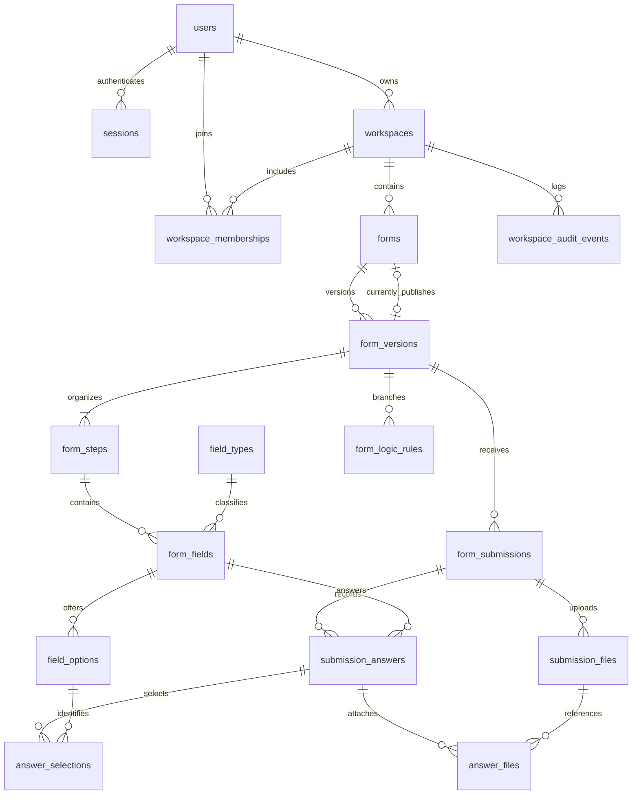

# Phase 1 database architecture proposal

Status: proposed; awaiting architecture approval before models or migrations are changed.

## Repository findings

- Retain PostgreSQL 15, Drizzle ORM 0.45.x, drizzle-kit 0.31.x, node-postgres, TypeScript, pnpm, and Turborepo. No new database, ORM, or hosted service is needed.
- `packages/database/schema.ts` exports model definitions. `drizzle.config.ts` reads that entry point and writes SQL, snapshots, and a migration journal under `drizzle/`.
- Existing migrations `0000` and `0001` create users, sessions, themes, mutable forms/fields, responses, and JSON answers. Preserve these migrations unchanged.
- Users and cookie-session authentication already exist. Preserve their exports and authentication contract; workspace permissions are distinct from the existing platform-wide user role.
- At inspection, form, response, and theme model files and several services/routes were already deleted in the working tree. Schema exports and the seed still reference those files. These are pre-existing inconsistencies, not changes made for this proposal.
- No repository `AGENTS.md` was found. No database tests or dedicated database type-check script currently exist. Dependencies are installed. PostgreSQL availability and actual deployed data have not been inspected.
- The README describes an earlier application state and is not an authoritative inventory of the current working tree.

## Design principles

Relational rows own identities, membership, ordering, relationships, lifecycle, and typed answers. JSONB holds extensible field configuration, validation definitions, condition expression trees, and settings. JSON does not replace foreign keys.

Every submission pins one immutable form version. Changing a draft or publishing a later version cannot change what an earlier respondent saw. All tenant-owned relationships carry workspace scope and use composite foreign keys to prevent cross-workspace references.

New tables use snake_case names, UUID primary keys with PostgreSQL-generated defaults, and non-null `timestamptz` creation timestamps. Mutable tables also have database-maintained `updated_at`. Use `numeric` for exact numeric answers, `bigint` for file byte counts, and explicit checks on positions, sizes, JSON shape, and lifecycle timestamps. Drizzle exports inferred insert/select types.

## Entities and principal constraints

| Entity | Purpose and important columns | Relationships and invariants |
| --- | --- | --- |
| `users` (existing) | Identity, email, password hash, platform role; add deletion timestamp | Keep existing IDs and auth exports; normalize email and enforce case-insensitive uniqueness after collision preflight. Soft-deleted identities must be rejected by auth before this feature is enabled. |
| `sessions` (existing) | Hashed session token and expiry | User FK cascades session deletion; unique token hash and expiry cleanup index. |
| `workspaces` | Tenant name, globally unique slug, `owner_user_id`, `deleted_at`, optional positive default retention days | Owner FK restricts hard deletion. Ownership is authoritative here; owner has implicit full workspace access. |
| `workspace_memberships` | Workspace/user pair, role `ADMIN`, `EDITOR`, or `VIEWER` | Unique pair; user and workspace FKs; roles use text with checks. Owner may also have membership, but its role cannot reduce owner authority. |
| `forms` | Stable identity, workspace, creator, globally unique public slug, archive/deletion timestamps, current published version pointer | Composite `(workspace_id, id)` key; creator is attribution, ownership belongs to workspace. Pointer must reference a published version of this same form. |
| `form_versions` | Form/workspace, positive version number, `DRAFT` or `PUBLISHED`, title, description, settings object, publication time, optimistic revision counter | Unique `(workspace_id, form_id, version_number)`; partial unique index permits one draft per form; published version content is immutable. |
| `form_steps` | Version-scoped key, title, non-negative position | Unique key and position within version; every field belongs to a step, including single-step forms. |
| `field_types` | Stable text code and storage kind | Small global registry seeded by migration. Examples: short text, long text, email, number, rating, boolean, date, datetime, single/multiple selection, file, structured JSON. New types reuse existing storage kinds without enum replacement. |
| `form_fields` | Version/workspace, step, stable field key, type code, label, required flag, position, configuration and validation objects | Unique field key per version and position per step; scoped FK guarantees step and field share the version. Stable key is used for deliberate cross-version analytics. |
| `field_options` | Version/workspace, field, stable option key, label, position | Unique key/position per field; composite FK guarantees correct field/version. Selection answers reference option rows, not labels. |
| `form_logic_rules` | Version/workspace, source field, priority, condition object, action kind, optional target step/field | Scoped FKs enforce target ownership. Checks enforce action/target shape. Condition AST includes a format version; semantic validation at publication rejects unknown references and unsupported operators. No general workflow engine. |
| `form_submissions` | Workspace/form/version, status `IN_PROGRESS`, `COMPLETED`, or `ABANDONED`, start/completion timestamps, optional respondent, metadata object, idempotency key, `deleted_at`, `expires_at` | Only published versions accept new submissions; unique non-null idempotency key per form; version cannot change. Anonymous submissions are supported. |
| `submission_answers` | Workspace/version/submission/field, storage kind, nullable typed text, numeric, boolean, date, datetime, JSON columns | Unique submission/field pair. Composite FKs force submission and field into the same workspace/version. Check requires exactly the matching scalar column, or no scalar for selection/file kinds. No row means unanswered; boolean false and numeric zero are real answers. |
| `answer_selections` | Answer/field/option plus workspace/version scope | Composite keys guarantee selected option belongs to the answered field; unique answer/option. Single-select cardinality enforced in database; multiple-select uses the same table. |
| `submission_files` | Workspace/version/submission, private object key, original filename, media type, byte count, checksum, upload state | Metadata only; no blobs, permanent public URLs, or storage credentials. A file belongs to exactly one submission. |
| `answer_files` | Answer/file link with workspace/version/submission scope | Composite FKs prevent attaching a file from another submission; unique attachment pair. Only file-kind answers accept links. |
| `workspace_audit_events` | Workspace, nullable actor, action, entity type/ID, timestamp, bounded metadata object | Append-only for runtime role; actor removal sets attribution null. Record lifecycle/security events, not raw answers or secrets. Entity ID is historical attribution, not a cascading polymorphic FK. |

The extra workspace/version columns are deliberate relational scope keys, not independent sources of truth. Add supporting unique keys only where required by composite foreign keys. Answer kind must match the field type's storage kind through a database guard; selection and file child rows must match the answer kind. Deferred constraint triggers validate final transaction state so answers and their child rows can be inserted together.

## Entity-relationship diagram

The current-version relationship is an optional pointer from each form; many historical published versions remain attached to that form. Workspace/version columns and individual actor relationships are omitted from the diagram for readability. A version may temporarily have zero steps while being drafted; publication validates its complete structure.

## Drafting, publication, and concurrency

1. Lock the form row before allocating the next version number or changing the published pointer. The unique version and draft constraints also protect competing writers.
2. Edit the single draft and its children in transactions. An expected revision counter prevents silently overwriting another editor's changes. Reordering uses deferrable position uniqueness or a transaction-safe temporary-position strategy.
3. Publication validates the complete draft: at least one step and field, supported type configuration, unique stable keys, choice cardinality, validation definitions, condition references, and reachable step targets. Required-answer semantics and JSON configuration are application validation responsibilities; SQL alone cannot express arbitrary field validators.
4. In one transaction, publish the version and switch the form pointer. Published content and its steps, fields, options, and rules are protected against update/delete by database triggers. Trigger writes lock/check the parent version to serialize concurrent draft edits against publication.
5. To edit again, copy the published structure into a new draft with new row IDs and the same logical field/option keys. Create row-ID mappings before copying rules. Do not treat reusing a key for a semantically different question as a safe analytics operation.
6. Unpublishing clears the pointer. Existing versions stay published and immutable. Closing intake rejects new starts; in-progress submissions may finish against their pinned version unless the form is deleted or retention has removed their data. No persisted version is rewritten into a draft.

Cross-row immutability and published-pointer validation require custom SQL triggers in addition to Drizzle table definitions. Their SQL and tests are first-class migration artifacts. Publication semantic validation must be implemented before any later application route can safely expose publishing.

## Answer storage and completion

Store searchable scalar answers in typed columns; use JSONB for genuinely structured custom answers. Preserve numeric values as decimal strings in JavaScript to avoid rounding. Date-only and timezone-aware datetime answers have separate storage kinds.

Selections and attachments use relational child tables. Their deferred checks enforce non-empty payloads and single-select limits at transaction commit. Multi-select configured minimum/maximum and file restrictions are validated against the pinned version by the submission service. Completed submissions may legitimately omit fields hidden by conditional logic.

Answer writes and completion lock the submission row. Database guards reject changes to completed/abandoned submissions and prohibit reverting a terminal status. Completion time is required only for completed submissions; all lifecycle times must be ordered. Retention deletion is a separate privileged operation, not a bypass available to ordinary writes.

Do not duplicate all answers into a JSON snapshot on every submission: the immutable version plus typed answer rows already preserves meaning. Exporters can construct a snapshot when needed. An optional respondent-user FK is attribution only and must not determine workspace access.

## Tenant isolation and authorization boundary

- Composite foreign keys reject cross-tenant inserts even when application code supplies valid UUIDs from another workspace. They do not authorize reads.
- Enable and force workspace-scoped row-level security on new tenant tables. Runtime queries use a non-owner, non-superuser role without `BYPASSRLS`; absent transaction-local workspace context denies access. Keep migrations on a separate privileged connection.
- A small database transaction helper sets workspace context with parameterized `set_config(..., true)` on the same transaction connection. Workspace context is trusted input from authenticated authorization code, never directly from request payloads. Pool checkout must never retain session-level tenant context.
- Ownership/membership checks grant owner/admin management access, editor form editing, and viewer read access. RLS supplies the tenant boundary; application permissions decide which operations each role may perform. The runtime database role must not be exposed to clients.
- Future public endpoints resolve a public slug through narrowly scoped trusted code, check intake state, and open a workspace-scoped transaction. Knowing a workspace ID grants no application access. No anonymous database role receives broad table access.
- The existing users/sessions remain global identity tables. Their access is restricted to server-side authentication code. Tenant RLS does not secure those tables or automatically retrofit deleted services.
- Integration tests must exercise forced RLS with a restricted role, including missing context and pool reuse. Tests run as table owner alone cannot establish isolation.

## Deletion, privacy, and audit

Workspace/form deletion is soft by default. Restrict user deletion while that user owns a workspace; transfer ownership first. Creator/actor/respondent attribution can be nullable on eventual identity erasure. Do not cascade deleting a creator into forms or responses, as the legacy schema currently allows.

Published definitions are retained while submissions reference them. Submission deletion cascades only its answers, selections, attachment links, and submission-owned file metadata. Physical object deletion needs an idempotent cleanup process; a SQL cascade cannot delete an external object. Keep a deletion manifest before removing metadata so failed object deletion can be retried. Storage integration and cleanup execution are future application work.

`expires_at` is captured when a submission starts from the workspace retention policy, with an optional form override. Null means no scheduled expiry, not immediate deletion. Changes to policy do not silently rewrite prior expiry times. Retention changes and explicit erasures are audited without retaining the erased content. Cleanup uses bounded batches and a privileged, documented purge path; account/workspace purges require an explicit orchestration procedure rather than unrestricted cascades.

Avoid collecting IP addresses/user agents by default. If enabled later, document purpose and expiry separately. Audit records have their own retention policy and must exclude tokens, passwords, private object URLs, and response contents. Soft deletion is not erasure and must never be described as such.

## Index and growth plan

| Query | Planned index |
| --- | --- |
| Workspace membership lookup and user's workspace list | Unique `(workspace_id, user_id)` and `(user_id, workspace_id)` |
| Active workspace form list, newest first | Partial `(workspace_id, created_at DESC, id DESC)` where `deleted_at IS NULL` |
| Public form lookup | Unique global slug; intake state checked after lookup |
| Version selection and draft lookup | Unique `(workspace_id, form_id, version_number)` and partial unique draft/form |
| Render version | Scoped step/field/option ordering keys, plus indexes on foreign-key child lookups |
| Submission cursor listing | `(workspace_id, form_id, created_at DESC, id DESC)` with active-row predicate |
| Completed response reports | `(workspace_id, form_id, completed_at DESC, id DESC)` for active completed submissions |
| Fetch submission answers | Unique `(workspace_id, submission_id, field_id)` |
| Numeric/date filtering per versioned field | Partial `(workspace_id, field_id, value_number, submission_id)` and date equivalent |
| Choice aggregation | `(workspace_id, option_id, answer_id)` |
| Retention scan | Partial `(expires_at, id)` where expiry is non-null |
| Audit trail | `(workspace_id, created_at DESC, id DESC)` |

Add indexes for referencing FK columns where existing leading index columns do not cover parent deletion/lookups. Do not add a blanket GIN index to every JSONB column or a B-tree over unbounded text answers. Add text-search/structured-answer indexes only against measured workloads.

Use cursor pagination with timestamp and UUID tie-breakers; no large OFFSET scans for responses. Fetch answer rows only for the requested submission page. Start with ordinary PostgreSQL tables: partitioning complicates unique keys and foreign keys and is deferred until measured table size, vacuum, retention, and query latency justify it. Analytics rollups, read replicas, and sharding are future choices, not Phase 1 dependencies.

## Migration and compatibility plan

1. Keep `0000`/`0001` and their journal entries unchanged. Introduce new models/migrations in logical stages: tenancy; versioned form definitions; submissions/typed answers; guards/RLS/indexes.
2. Use additive names or explicit legacy table renames where old names collide. Preserve old tables and data in a clearly named legacy area until reconciliation and cutover approval; do not generate destructive drops merely because model source files were deleted.
3. Give each existing form owner a personal workspace and backfill legacy forms into that workspace. Preserve form/public slug identities where possible. Snapshot available field definitions into an initial version and copy options into relational rows.
4. Legacy fields were mutable. Historical definitions cannot be reconstructed from current fields. Legacy answers may have null field IDs, missing/deleted keys, mismatched JSON shapes, or keys with no current field. Preserve their original JSON, identifiers, and timestamps in legacy tables; never invent historical labels or coerce bad values silently.
5. Backfill only records whose provenance and type mapping can be established. Record counts and rejection reasons in a reconciliation report. Unsupported legacy submissions remain readable through a documented legacy export path; they are not falsely represented as answers against an accurately reconstructed version.
6. Preflight duplicate normalized emails, orphan rows, duplicated answer keys, and invalid choice values. Fail with actionable diagnostics before enabling conflicting constraints. Interpret legacy timezone-naive timestamps using a documented source timezone (proposed default UTC); do not rely on the migration session timezone.
7. For a populated deployment, separate expansion/backfill from application cutover and later cleanup; coordinate concurrent legacy writes using a maintenance window or an explicit dual-write plan. Do not claim a single blocking migration is a zero-downtime upgrade.
8. Replace stale schema exports and database seed references only during approved implementation. Retain the legacy theme table for data compatibility; introduce no new theme features. Use development-only fixtures without seeded production passwords.
9. Drizzle-generated SQL/snapshots cover declarative schema. Custom journaled SQL handles backfills, triggers, RLS, and grants. Keep the declarative schema and SQL synchronized so later generation does not remove protection or legacy data unexpectedly.
10. Never point automated validation at the application's configured database. Use an explicitly supplied disposable PostgreSQL database and an isolated test runtime role. Rollback is restore/forward repair; do not supply a misleading destructive down migration.

## Validation and acceptance criteria

Implementation is accepted only after:

- Database package type-check and Drizzle schema validation pass; generating again reports no unexpected schema changes.
- All migrations apply to an empty disposable PostgreSQL 15 database and rerunning the migrator makes no changes.
- Upgrade tests start from `0000`/`0001` with realistic users/forms/responses, including malformed legacy answers, and prove preservation/reconciliation without silently dropping data.
- Database integration tests prove cross-workspace/version/submission FKs, invalid payload shapes, wrong answer storage kinds, wrong choice/file ownership, duplicate keys/positions, single-select limits, and lifecycle checks reject invalid writes.
- Tests prove immutable published definitions, safe concurrent draft edits/publication, old-version response readability, and completed-submission protection.
- Restricted-role tests prove missing/wrong workspace contexts deny access, same-workspace operations work, and transaction context does not leak through pooled connections.
- Representative response pagination/filter queries use suitable indexes under realistic fixture volume; document query plans without claiming a synthetic benchmark establishes production capacity.
- Database documentation includes setup, migration, role configuration, retention/erasure procedures, known limits, and a commit ledger. Existing unrelated type/build failures are reported separately.

Tests are warranted here because cross-table integrity, migrations, and security boundaries are material production behavior. No UI, API product features, email integration, theming, or general workflow runner is included.

## Planned atomic implementation commits

1. `feat(db): add workspace tenancy and membership models`
2. `feat(db): add immutable versioned form definitions`
3. `feat(db): add typed submissions and answer relationships`
4. `feat(db): enforce lifecycle guards and tenant isolation`
5. `test(db): verify migrations integrity and tenant boundaries`
6. `docs(db): document operations validation and migration rollout`

Each commit will include coherent model/migration changes or focused verification/documentation. Only task-owned paths will be staged; existing working-tree edits will remain untouched. No remote push is authorized.

## Reference documentation

- [PostgreSQL 15 constraints](https://www.postgresql.org/docs/15/ddl-constraints.html): use composite foreign keys for cross-row identity; CHECK constraints cannot enforce arbitrary cross-table conditions.
- [PostgreSQL 15 row security](https://www.postgresql.org/docs/15/ddl-rowsecurity.html): account for owner/superuser bypass and FORCE ROW LEVEL SECURITY.
- [Drizzle migrations](https://orm.drizzle.team/docs/migrations) and [custom migrations](https://orm.drizzle.team/docs/kit-custom-migrations): retain generated history and journal custom database behavior.

## Approval requested

Approve this relational/versioned design and the preservation-first migration strategy before implementation. The proposal deliberately retains unreconstructable legacy responses rather than pretending their original form definitions are known. Production cutover will additionally need confirmed legacy timestamp timezone and deployment/write-traffic information; those do not prevent implementing and testing the new schema against disposable databases.
