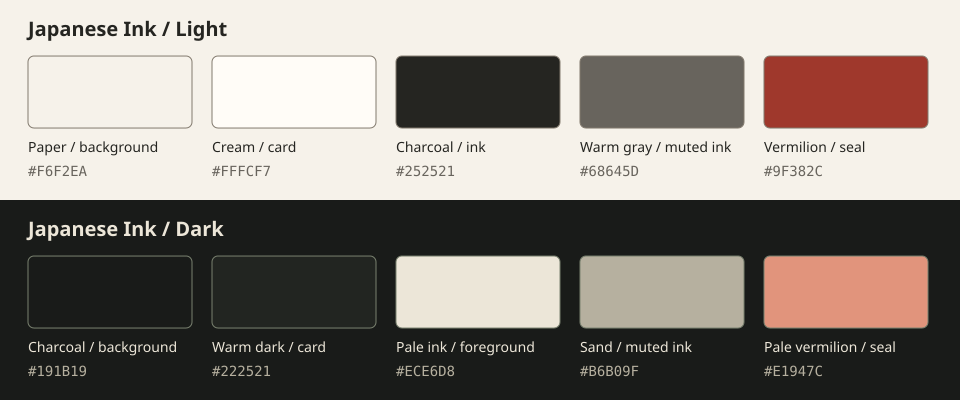

# Japanese Ink theme

Status: initial selectable form-theme specification for future UI implementation. The [Sumikami brand guide](../brand/sumikami.md) defines the product identity and takes precedence for product chrome, brand colors and typography.

Japanese Ink gives a Sumikami form a calm, deliberate character through warm paper surfaces, charcoal typography, generous space, and small vermilion accents. The form content remains the focus. This guide defines one respondent-facing preset and its preview in the builder, rather than requiring every Sumikami form to look Japanese.

The light/dark values and SVG below remain the preset's initial color study; they are not the authoritative six-color Sumikami brand palette. Dashboard/builder composition notes are supporting UX guidance, with the brand guide governing the surrounding product interface. Other presets can have substantially different visual expression.

This is a design specification. The current UI still uses its starter styles. No theme renderer, new font dependency, asset download, or database migration is introduced by this document.

## Visual principles

- **Paper and ink:** use warm neutral surfaces and clear, dark text. Separate sections through spacing and quiet rules before adding containers.
- **Deliberate emphasis:** reserve vermilion for small identity details, focus indicators, and selected navigation. Primary action buttons use solid ink.
- **Space with purpose:** give respondent questions room to breathe; keep the creator's tools compact enough for sustained editing.
- **Readable craft:** combine occasional serif headings with the existing sans-serif interface. Functional text, icons, and hit areas remain precise.
- **Restrained decoration:** an optional brush mark may appear on a welcome or empty-state illustration. Keep textures away from text and controls. Decorative elements must be non-interactive and hidden from assistive technology.

Avoid ornamental Japanese characters, imitation calligraphy in controls, landscape backgrounds behind questions, or ink splashes around every component. Use actual Japanese text only when it is meaningful, translated, and reviewed. The direction comes from composition and material cues.

## Color foundations

Light mode is the primary reference: a paper-like canvas with slightly brighter content surfaces. Dark mode uses warm charcoal and pale ink. Treat both as intentional palettes; do not invert colors mechanically.

The values below are initial defaults. Names map to the CSS variables already exposed in `apps/web/app/globals.css`. Values are opaque sRGB hex colors; implementers may convert their notation while preserving appearance and contrast.

| Token                      | Light     | Dark      | Intended use                                                           |
| -------------------------- | --------- | --------- | ---------------------------------------------------------------------- |
| `--background`             | `#F6F2EA` | `#191B19` | Main canvas                                                            |
| `--foreground`             | `#252521` | `#ECE6D8` | Body text and headings                                                 |
| `--card`                   | `#FFFCF7` | `#222521` | Cards and editable form surfaces                                       |
| `--card-foreground`        | `#252521` | `#ECE6D8` | Text on cards                                                          |
| `--popover`                | `#FFFCF7` | `#292D27` | Menus, dialogs, tooltips                                               |
| `--popover-foreground`     | `#252521` | `#ECE6D8` | Overlay text                                                           |
| `--primary`                | `#252521` | `#ECE6D8` | Main action fill                                                       |
| `--primary-foreground`     | `#FFFCF7` | `#191B19` | Main action label                                                      |
| `--secondary`              | `#EAE4D8` | `#2D312B` | Secondary action fill                                                  |
| `--secondary-foreground`   | `#252521` | `#ECE6D8` | Secondary action label                                                 |
| `--muted`                  | `#EDE7DC` | `#252923` | Quiet backgrounds                                                      |
| `--muted-foreground`       | `#68645D` | `#B6B09F` | Supporting text and placeholders                                       |
| `--accent`                 | `#F0E0D7` | `#352A24` | Selected or hovered subtle surfaces                                    |
| `--accent-foreground`      | `#6F2D25` | `#F1B09A` | Labels/icons on accent surfaces                                        |
| `--border`                 | `#D8D1C5` | `#464B41` | Decorative dividers and card boundaries                                |
| `--input`                  | `#827A6E` | `#79816F` | Required visible input/control boundaries                              |
| `--ring`                   | `#9F382C` | `#E1947C` | Focus outline                                                          |
| `--destructive`            | `#A12C32` | `#F19A9D` | Error text and destructive fill                                        |
| `--destructive-foreground` | `#FFFCF7` | `#191B19` | Label on a filled destructive action; add semantic mapping when needed |
| `--seal`                   | `#9F382C` | `#E1947C` | New optional brand-detail token                                        |
| `--success`                | `#3F614E` | `#9FB79B` | Success text/icon; pair with a label                                   |
| `--warning`                | `#805D22` | `#DDBB7B` | Warning text/icon; pair with a label                                   |

`--accent` is a tinted surface, not a vermilion button fill. `--border` is intentionally quiet and must not be the only indication of an interactive control; use `--input` for necessary control outlines. Success/warning colors above are foregrounds, not approved filled-button combinations.

Sidebar tokens should reference the same roles: sidebar background uses `--background`, text uses `--foreground`, selected rows use `--accent`/`--accent-foreground`, and focus uses `--ring`. Use `--border` for decorative separators. Keep the builder canvas distinguishable from its surrounding tools through surface and spacing rather than heavy shadows.

Charts should use a restrained categorical set derived from ink, vermilion, moss, ochre, and slate. Define and test chart-specific tokens when charts are built. Add direct labels, symbols, patterns, or a data table so color is never the only way to distinguish series; brand colors alone do not guarantee chart accessibility.

## Typography

The current scaffold bundles Geist Sans and Geist Mono in `apps/web/app/fonts`; the table below records that interim implementation baseline. The selected Sumikami direction is Inter for interface text and ordinary questions, with Noto Serif JP for suitable editorial/Japanese accents. Apply those choices in the future UI phase after font integration review. Georgia/system serif and bundled Geist remain temporary fallbacks, not competing brand-font selections.

| Role                                 | Font stack                                      | Suggested size / line height | Weight |
| ------------------------------------ | ----------------------------------------------- | ---------------------------- | ------ |
| Product or form welcome heading      | `Georgia, "Times New Roman", serif`             | 40–56px / 1.15               | 400    |
| Respondent question heading          | `Georgia, "Times New Roman", serif`             | 28–36px / 1.25               | 400    |
| Application page title               | Existing Geist Sans, system sans-serif fallback | 24–32px / 1.25               | 600    |
| Section heading                      | Existing Geist Sans, system sans-serif fallback | 18–20px / 1.4                | 600    |
| Body and respondent input            | Existing Geist Sans, system sans-serif fallback | 16px / 1.6                   | 400    |
| Toolbar, labels and compact controls | Existing Geist Sans, system sans-serif fallback | 14px / 1.4                   | 500    |
| Help text and metadata               | Existing Geist Sans, system sans-serif fallback | 13–14px / 1.5                | 400    |
| IDs, shortcuts and technical values  | Existing Geist Mono, system monospace fallback  | 12–14px / 1.5                | 400    |

Use the smaller end of display sizes on mobile. Keep paragraph width around 60–70 characters and respondent content around 640–720px maximum. Use relative units and fluid wrapping; the suggested sizes are starting points, not fixed-height constraints. Avoid long uppercase labels and excessively tracked small text. Use tabular numerals for reporting values where supported.

Do not use the serif for the entire builder interface. If Japanese-language content is introduced, define suitable Japanese font fallbacks and verify wrapping; the bundled fonts and Latin serif stack alone do not establish Japanese text support.

## Spacing, shape, and depth

Use a 4px spacing base, with common steps of 4, 8, 12, 16, 24, 32, 48, and 64px. Begin with 24–32px panel padding on desktop and 16–20px on narrow screens. Maintain a clear separation between a label, its control, its help text, and the next field.

Use modest rounding: 4px for compact controls, 6px for inputs/buttons, 8px for cards, and 12px for dialogs. Set the existing base `--radius` to 8px during implementation and review its derived sizes. Use fully rounded shapes for avatars and deliberate pills, not every surface.

Prefer 1px borders and minimal depth. A suitable starting shadow for a floating surface is `0 8px 24px rgb(37 37 33 / 10%)` in light mode; in dark mode, use surface contrast and borders first. Reserve stronger elevation for menus and dialogs.

Texture is optional, confined to large non-interactive background areas, and never required to communicate structure. Start with flat colors. If texture is added later, verify the actual worst-case contrast beneath text; the palette ratios below apply only to solid backgrounds.

## Components and interaction states

| Component             | Treatment                                                                     | Required states                                               |
| --------------------- | ----------------------------------------------------------------------------- | ------------------------------------------------------------- |
| Primary button        | Ink fill with paper label; clear verb such as “Publish form”                  | Default, hover, pressed, focus, disabled, loading             |
| Secondary button      | Secondary surface or input-strength outline; quiet label                      | Same states as primary; selection differs from hover          |
| Destructive action    | Explicit label and destructive semantic color                                 | Confirmation for irreversible actions; error/loading feedback |
| Text input / textarea | Card surface, visible label, input-strength boundary                          | Hover, focus, populated, read-only, disabled, invalid         |
| Choice card           | Paper/card surface and clear selection indicator                              | Unselected, selected, keyboard focus, disabled, invalid       |
| Tabs / navigation     | Compact text; accent surface and optional seal-colored indicator              | Active state exposed semantically, hover, focus               |
| Form/question card    | Generous interior space, quiet border; strong selection outline while editing | Idle, selected, editing, dragging, error                      |
| Dialog / popover      | Solid surface, readable boundary, restrained shadow                           | Focus management, dismissal, loading, error                   |
| Response table        | Compact sans-serif, aligned numbers, quiet row separators                     | Hover/focus, selected row, sort state, empty, loading, error  |
| Status badge / notice | Text label with optional icon and subtle semantic treatment                   | Success, warning, error, informational                        |

Default hover should change a solid fill or boundary, not lower the opacity of the entire component. Focus uses a solid 2px `--ring` outline with a 2px offset from the component. Test it against every adjacent surface. Keep selected state visible when focus moves elsewhere.

Invalid fields need a text explanation linked to the control, alongside the visual state. Selected choices need a check/radio indicator and semantic checked state. Loading buttons retain a meaningful label and prevent duplicate activation. Disabled controls need a clear reason when the unavailable action would otherwise be confusing.

Use existing Lucide icons consistently, generally 16–20px with a 1.5–2px stroke. Give icon-only actions accessible names. The artwork may suggest ink; icons and interaction targets should remain crisp.

## Screen composition

### Creator dashboard

Use a quiet sidebar, a clear page title, and a compact action area. Let form titles, publication state, and response counts lead. Empty states should explain the next action, with at most one small decorative mark. Avoid large decorative hero areas above routine work.

### Form builder

Use three areas on wide screens: structure navigation, the form canvas, and contextual field settings. The canvas gets the brightest paper surface. Selected fields use a clear outline; errors, saving, and publication status have distinct text labels. Keep autosave feedback separate from the publish action.

On narrow screens, show one primary area at a time and move structure/settings into accessible drawers or panels. Dragging must have keyboard and button-based alternatives such as “Move up” and “Move down.” Do not rely on drag handles as the only way to arrange questions.

### Respondent form

Use a focused content column, strong question hierarchy, persistent field labels, and a clear next/submit action. Progress should communicate position without dominating the page. Preserve entered answers when validation fails, and move focus deliberately when navigating steps. Completion uses a concise confirmation; animation is optional.

Japanese Ink may be offered as a default or selectable preset; do not assume that all respondent experiences inherit it. Future author customization must preserve readable text/control combinations and accessible focus/error states. A theme preview should use the same rendering rules as the published form.

## Motion

Use 120–180ms transitions for hover/focus details and 180–240ms for panels or step changes. Prefer opacity and a small displacement where helpful. Avoid liquid ink trails, background parallax, ornamental cursor effects, or animation that delays input.

Honor `prefers-reduced-motion`: remove spatial transitions and decorative motion while keeping state changes understandable. Do not make completion, navigation, or error discovery depend on animation.

## Accessibility and contrast

Target WCAG 2.2 AA. Normal text needs at least 4.5:1 contrast, large text at least 3:1, and required non-text control/state indicators at least 3:1 against adjacent colors. Use color together with labels or shape. See W3C's guidance for [text contrast](https://www.w3.org/WAI/WCAG22/Understanding/contrast-minimum.html) and [non-text contrast](https://www.w3.org/WAI/WCAG22/Understanding/non-text-contrast.html).

Calculated sRGB ratios for selected solid-color pairs, rounded to two decimal places:

| Pair                                                  | Ratio   |
| ----------------------------------------------------- | ------- |
| Light body `#252521` on canvas `#F6F2EA`              | 13.78:1 |
| Light supporting text `#68645D` on canvas             | 5.27:1  |
| Light seal `#9F382C` on canvas                        | 6.11:1  |
| Light input boundary `#827A6E` against card `#FFFCF7` | 4.14:1  |
| Light accent label `#6F2D25` on accent `#F0E0D7`      | 7.87:1  |
| Light destructive label `#FFFCF7` on fill `#A12C32`   | 7.02:1  |
| Dark body `#ECE6D8` on canvas `#191B19`               | 13.92:1 |
| Dark supporting text `#B6B09F` on card `#222521`      | 7.16:1  |
| Dark seal `#E1947C` on canvas                         | 7.20:1  |
| Dark input boundary `#79816F` against card            | 3.83:1  |
| Dark accent label `#F1B09A` on accent `#352A24`       | 7.57:1  |
| Dark destructive label `#191B19` on fill `#F19A9D`    | 8.13:1  |

These are palette checks, not an accessibility certification. Recheck rendered text, overlays, hover/selected states, focus boundaries, and custom form overrides. Use text underlines for inline links. Keep error, required, saved, and publication states understandable without color.

Aim for 44px touch targets for primary controls and icon-button hit areas. Dense desktop tools may be smaller with adequate spacing and verified accessibility. Test keyboard-only use, visible/unobscured focus, screen-reader labels, 200% text zoom, and 320 CSS-pixel reflow. Reflowing builder tools into panels is preferable to forcing the entire workspace into horizontal scrolling.

## Fit with the current project

The project already has Tailwind CSS, shadcn-style semantic variables, Radix-based components, locally loaded Geist fonts, and a `next-themes` dependency. Reuse those foundations. Define palette values centrally and let components consume semantic roles rather than scattering hex values through TSX.

The root layout currently forces `.dark`, and its metadata still contains starter branding. Future implementation should replace the forced mode with deliberate system/light/dark behavior and update product metadata. Keep this guide's light palette as the design reference; honor the user's chosen mode when mode switching is implemented.

Application theme and form appearance are separate settings: an author's dashboard mode should not silently rewrite a published form's appearance. The database's immutable `form_versions.settings` can hold a future validated appearance configuration when that feature is implemented. Define its format/preset version and snapshot the resolved values at publication; a later preset update should not silently restyle older versions. Do not repurpose the legacy themes table or add migrations for this documentation step.

## Implementation order and review criteria

1. Map the central color/font/radius tokens and theme-mode behavior; verify a small light/dark component preview.
2. Apply the theme to buttons, inputs, choices, navigation, dialogs, and notices, including all interaction states.
3. Compose the dashboard, builder, respondent form, and response table with the shared foundations.
4. Review real long labels, validation errors, empty/loading states, mobile tools, keyboard use, and both modes.
5. Add optional decorative artwork only where the working interface benefits from it.

Before accepting a themed screen, confirm that its hierarchy is clear without decoration, all text and controls remain legible, primary actions are identifiable, selected/error/focus states are distinct, and decorative assets neither obscure content nor prevent interaction. Changes to shared tokens should update this guide and be checked across creator and respondent screens.
